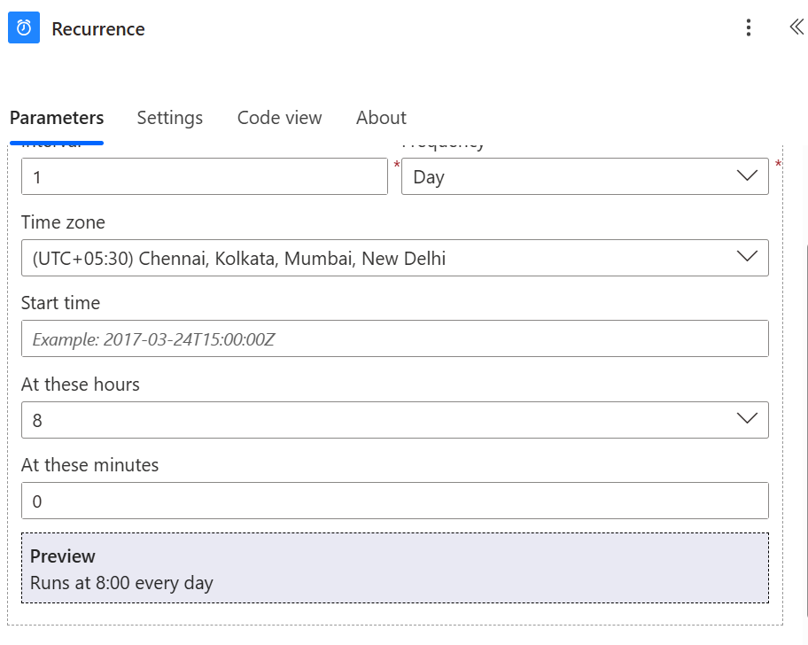
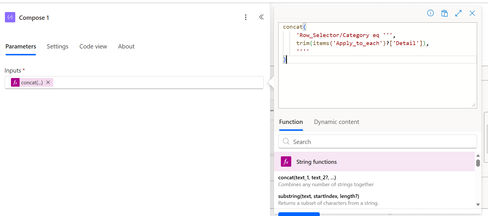

# Automated-Power-BI-PDF-Distribution

# Automated Power BI PDF Distribution Using Power Automate

## 📌 Introduction

As part of my Power BI and Power Automate learning journey, I developed an automated workflow to distribute Power BI reports as PDF attachments to intended recipients.

The workflow uses a SharePoint-hosted Excel mapping table to manage recipient email addresses and report filter values. Microsoft Power Automate processes the mapping records, prepares the required values, exports the Power BI report to PDF, and sends the generated file through email.

This project helped me understand how Power BI reporting can be integrated with workflow automation to reduce manual effort and improve reporting efficiency.

## 🎯 1. Project Objectives

The main objectives of this project are:

* Automate the distribution of Power BI reports in PDF format.
* Use a scheduled Power Automate flow to trigger report delivery.
* Store recipient information and filter values in an Excel mapping table hosted in SharePoint.
* Process multiple recipient records using the `Apply to each` action.
* Use Compose and Condition actions to prepare values and control the workflow.
* Export the required Power BI report pages using configured page-level filters.
* Send PDF attachments to the intended recipients through email.

### My Key Learning

I learned how Microsoft Power Automate can connect different Microsoft services and automate repetitive reporting tasks through a structured workflow.

## 🏗️ 2. Understanding the Workflow

The workflow consists of multiple actions that work together to automate report distribution.

### Recurrence Trigger

The Recurrence trigger starts the flow according to its configured schedule.

* Configure the frequency and interval for the workflow.
* Run the report distribution process automatically.
* Reduce the need to start the flow manually for every scheduled delivery.

### List Rows Present in a Table

This action retrieves records from the Excel mapping table stored in SharePoint.

* Read recipient email addresses.
* Retrieve report filter values.
* Access mapping records for subsequent processing.

### Apply to Each

The `Apply to each` action processes the records returned by the Excel table action.

* Process individual mapping records.
* Access values from each record.
* Pass the required information to subsequent Compose and Condition actions.

### Compose Actions

Compose actions prepare values that are used by other actions in the flow.

* Extract or prepare recipient information.
* Prepare report filter values.
* Simplify expressions used in subsequent workflow actions.

### Condition Actions

Condition actions evaluate configured expressions and determine which workflow path should execute.

* Check values from the mapping table.
* Control subsequent processing based on configured conditions.
* Help determine the appropriate report distribution path.

### Power BI Export to PDF

The export action generates the required Power BI report output as a PDF using the configured export parameters.

* Select the relevant report and report pages.
* Apply the configured page-level filters.
* Generate the PDF attachment for email delivery.

The exact export behavior depends on the report configuration, filter expressions, permissions, and Power Automate action settings.

### Email Delivery

The email action sends the generated PDF attachment to the intended recipient.

* Use the recipient email address from the mapping table.
* Attach the generated PDF file.
* Deliver the report through the configured email connection.

## 🔄 3. Complete Workflow

The overall workflow follows these steps:

1. The Recurrence trigger starts the flow.
2. The Excel mapping records are retrieved from SharePoint.
3. The `Apply to each` action processes the records.
4. Compose actions prepare the required recipient and filter values.
5. Condition actions evaluate the configured logic.
6. Power BI exports the required report pages to PDF.
7. The email action sends the PDF attachment to the intended recipient.

### My Key Learning

Breaking the workflow into individual actions makes the automation easier to understand, maintain, test, and troubleshoot.

## 🖼️ 4. Complete Power Automate Flow Screenshot

*Overview of the automated Power BI report distribution workflow, including the main trigger, data processing, conditions, report export, and email delivery actions.*

## ⏰ 5. Scheduled Trigger

The Recurrence trigger is the starting point of the automated workflow.

### What I Learned

* Configure a schedule for automated execution.
* Start the workflow without manual intervention at each scheduled interval.
* Coordinate report distribution with business reporting requirements.
* Monitor scheduled runs through Power Automate run history.

### Example Use Case

A business may need to distribute its Power BI reports at a specific time each day or week. A Recurrence trigger can initiate the workflow according to the configured schedule.

## 🖼️ Scheduled Trigger Screenshot

*The Recurrence trigger starts the flow according to its configured schedule.*

## 📊 6. SharePoint Recipient Mapping

The workflow uses an Excel mapping table stored in SharePoint as its centralized source for recipient and report-filter information.

The table contains the following columns:

| Column Name | Purpose |
|---|---|
| `Detail` | Identifies the recipient group, reporting category, or mapping record. |
| `Email ID` | Stores the recipient email address or distribution destination. |
| `Page-level-filter` | Stores the first configured page-level filter value. |
| `Page-level-filter2` | Stores the second configured page-level filter value. |

### What I Learned

* Maintain recipient information in a centralized table.
* Retrieve Excel records through Power Automate.
* Use mapping values in subsequent workflow actions.
* Update recipient and filter information without redesigning the entire workflow, provided the existing table structure remains compatible.

### Example Use Case

Different recipient groups may require reports filtered according to different business categories or reporting requirements. The mapping table provides a configurable way to associate recipient details with the required filter values.

The actual relationship between each mapping column and the Power BI export parameters depends on the expressions and configuration used in the flow.

## 🖼️ SharePoint Mapping Screenshot

*The Excel mapping table stores recipient groups, email addresses, and report-filter values.*

## 🧩 7. Compose Actions

Compose actions are used to prepare and organize values needed by subsequent steps in the flow.

### What I Learned

* Work with values retrieved from Excel.
* Prepare recipient information and filter parameters.
* Use expressions to reference values from the current mapping record.
* Make complex workflow logic easier to organize and troubleshoot.

### Example Use Case

When a mapping record is processed, Compose actions can prepare the relevant filter values and email destination for use in later Condition, export, and email actions.

The exact expressions depend on the column names and the structure of the flow.

## 🖼️ Compose Actions Screenshot

*Compose actions prepare the values used in conditional logic and report selection.*

## 🔀 8. Condition Actions and Report Selection

Condition actions help control the flow based on values retrieved from the mapping table.

### What I Learned

* Evaluate configured expressions.
* Direct workflow execution along different paths.
* Organize processing logic based on mapping values.
* Improve control over report distribution.

### Example Use Case

A condition can check whether a required mapping value is present or determine which processing path should run for a particular record.

The conditions should be configured according to the actual business requirements and the structure of the flow.

## 📄 9. Power BI PDF Export and Page-Level Filters

The Power BI export step generates the report output as a PDF for distribution.

### What I Learned

* Configure the report export action.
* Select the required report pages where supported.
* Pass configured page-level filter values to the export action.
* Prepare the generated PDF for the email action.
* Validate the exported report before distributing it to recipients.

### Example Use Case

A report may contain multiple pages and business categories. Configured page-level filters can help produce report output that matches the intended reporting requirements.

The exported PDF must be checked to confirm that the filters were applied as expected.

### Important Security Note

Page-level filters control which data is displayed in the exported report. They do **not** replace Row-Level Security (RLS).

If the report contains sensitive data, validate the semantic model's RLS configuration, the identity used to export the report, Power BI permissions, and the final PDF contents before sending the file.

## 📧 10. Automated Email Delivery

After the PDF is generated, the email action sends it to the intended recipient.

### What I Learned

* Configure the email recipient dynamically using mapping data.
* Attach the generated PDF file.
* Use email actions as part of an automated reporting workflow.
* Validate that the correct attachment is sent to the correct recipient.

### Example Use Case

A reporting team can use the flow to send scheduled PDF reports to the relevant business recipients without manually exporting and attaching each report.

## 🖼️ Email Delivery Screenshot

*The email action sends the selected PDF report attachments to the intended recipients.*

## 🔐 11. Security and Validation

Automated report distribution requires more than correctly applying report filters.

### Important Considerations

* Verify that the SharePoint Excel file is accessible only to authorized users.
* Confirm that the Power BI export connection has the required permissions.
* Validate semantic model RLS wherever row-level restrictions are required.
* Confirm the security context used when exporting the report.
* Check that each PDF contains only the information its recipients are authorized to access.
* Test the flow with representative mapping records before enabling production delivery.
* Review flow run history and troubleshoot failed exports or emails.

### My Key Learning

Correctly configured automation should provide both reliable delivery and appropriate data protection. Page-level filters alone should never be treated as a security boundary.

## 📈 12. Benefits of the Automation

Through this project, I explored several benefits of automating report distribution.

* **Time savings:** Reduces repetitive manual exporting and emailing.
* **Consistency:** Uses a centralized mapping table for recipients and filter values.
* **Scalability:** Supports processing multiple mapping records.
* **Maintainability:** Makes recipient and filter updates easier to manage.
* **Automation:** Reduces the need for manual intervention during scheduled report delivery.
* **Improved reporting operations:** Helps deliver reports according to configured business requirements.

## 🧪 13. Testing and Troubleshooting

Before using the workflow in production, the following checks are important:

1. Verify that the Excel table name and column names match the flow configuration.
2. Confirm that the SharePoint file is accessible through the configured connection.
3. Check that `List rows present in a table` returns the expected records.
4. Validate Compose outputs and Condition results.
5. Confirm that the correct filter values are passed to the Power BI export action.
6. Open the generated PDF and verify its contents.
7. Confirm that the email recipient and attachment are correct.
8. Review the Power Automate run history for errors.
9. Validate permissions and RLS behavior before sending sensitive reports.

## 🎯 14. Key Takeaways

Through this project, I gained a better understanding of:

* Automating Power BI report distribution using Microsoft Power Automate.
* Scheduling workflows with the Recurrence trigger.
* Retrieving Excel mapping records from SharePoint.
* Processing records using `Apply to each`.
* Preparing values using Compose actions.
* Controlling workflow execution with Condition actions.
* Exporting Power BI reports to PDF with configured page-level filters.
* Sending PDF attachments through automated email actions.
* Validating permissions and security requirements for report distribution.
* Integrating Microsoft Power BI, Excel, SharePoint, and Outlook into a reporting workflow.

## 🚀 15. Future Enhancements

Potential improvements to this project include:

* Add error handling and retry logic for failed exports.
* Send failure notifications to the report administrator.
* Maintain a log of processed records and email delivery attempts.
* Validate email addresses and required filter values before processing.
* Prevent duplicate email delivery where necessary.
* Extend the mapping table to support additional reports and filter fields.
* Improve monitoring and troubleshooting for scheduled flow runs.

## 👨‍💻 Conclusion

This project demonstrates how Microsoft Power BI and Power Automate can be integrated with SharePoint, Excel, and Outlook to automate PDF report distribution.

By using a centralized mapping table, scheduled triggers, workflow conditions, report export actions, and automated emails, the solution helps reduce repetitive manual tasks and improve the consistency of reporting operations.

This hands-on project strengthened my understanding of workflow automation, dynamic data processing, report distribution, and the importance of validating security when sharing Power BI reports.

---

**Project:** Automated Power BI PDF Distribution Using Power Automate

**Author:** Nagraj Baggon

